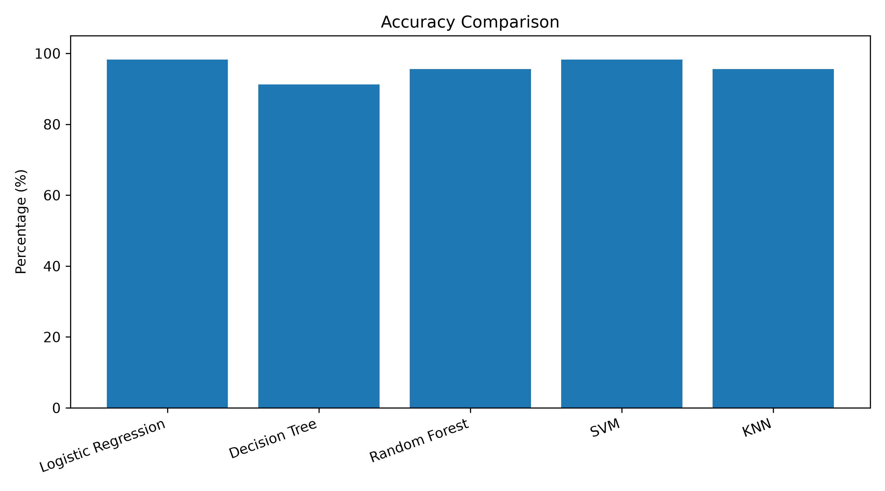
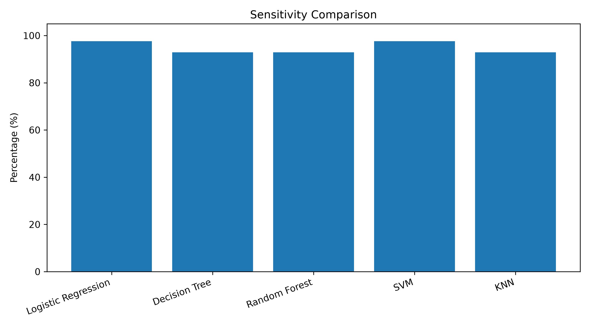
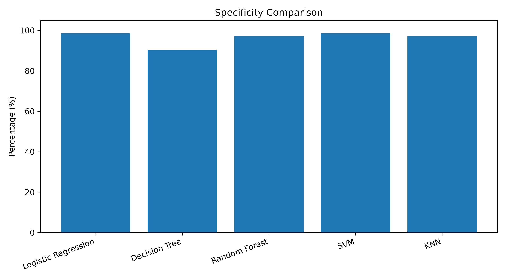
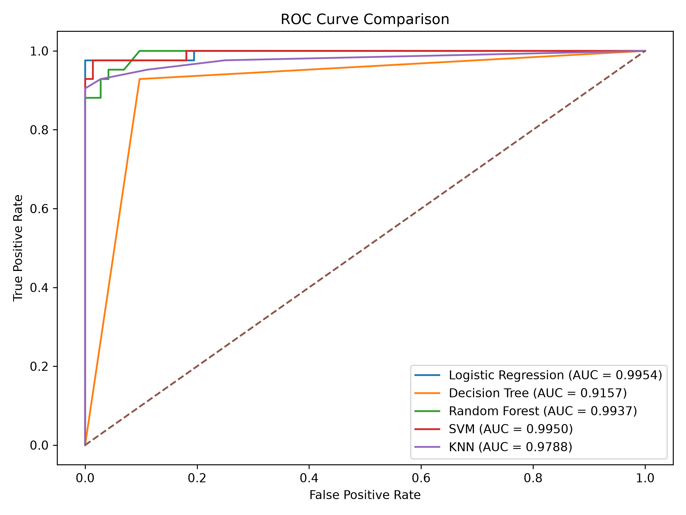
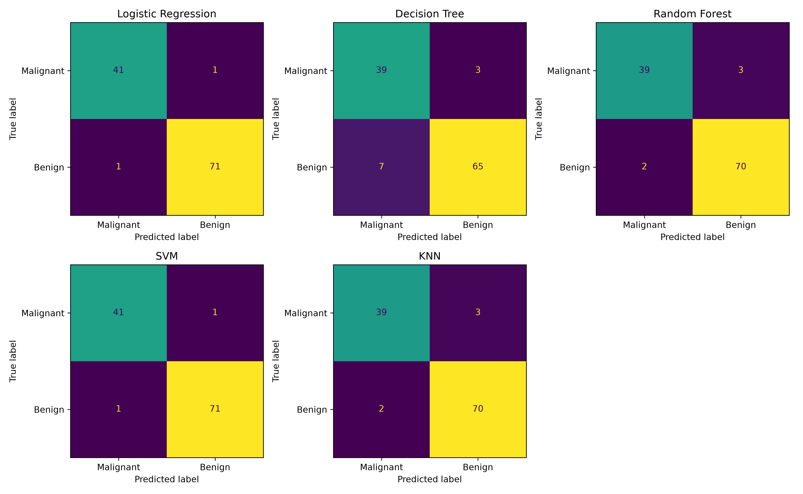

# Breast Cancer Classification

A Machine Learning project that compares the performance of five classification algorithms using the Breast Cancer Wisconsin Diagnostic dataset.

## Project Overview

The main goal of this project is to apply and compare different machine learning algorithms for classifying breast cancer cases as **Malignant** or **Benign**.

The project evaluates the models using several performance metrics to understand their strengths and weaknesses.

## Dataset

This project uses the **Breast Cancer Wisconsin Diagnostic Dataset**, which is available through Scikit-learn.

- **Total samples:** 569
- **Total features:** 30
- **Classes:** Malignant and Benign
- **Missing values:** 0

The dataset contains numerical measurements computed from digitized images of fine needle aspirates (FNA) of breast masses.

### Target Classes

- `0` = Malignant
- `1` = Benign

## Machine Learning Models

Five classification algorithms are implemented and compared:

1. Logistic Regression
2. Decision Tree
3. Random Forest
4. Support Vector Machine (SVM)
5. K-Nearest Neighbors (KNN)

StandardScaler is used with Logistic Regression, SVM, and KNN.

## Evaluation Metrics

The models are evaluated using the following metrics:

- Accuracy
- Sensitivity
- Specificity
- Precision
- F1-score
- ROC-AUC
- False Negatives
- False Positives

## Project Results

The following table shows the results obtained on the test dataset:

| Model | Accuracy | Sensitivity | Specificity | ROC-AUC |
|---|---:|---:|---:|---:|
| Logistic Regression | 98.25% | 97.62% | 98.61% | 0.9954 |
| Decision Tree | 91.23% | 92.86% | 90.28% | 0.9157 |
| Random Forest | 95.61% | 92.86% | 97.22% | 0.9937 |
| SVM | 98.25% | 97.62% | 98.61% | 0.9950 |
| KNN | 95.61% | 92.86% | 97.22% | 0.9788 |

Logistic Regression and SVM achieved the highest test accuracy in this experiment.

## Visualizations

The project generates five visualization files:

### 1. Accuracy Comparison


### 2. Sensitivity Comparison


### 3. Specificity Comparison


### 4. ROC Curve Comparison


### 5. Confusion Matrices


## Project Structure

```text
breast-cancer-classification/
│
├── common.py
├── inspect_dataset.py
├── train_models.py
├── model_statistics.py
├── visualize_results.py
│
├── accuracy_comparison.png
├── sensitivity_comparison.png
├── specificity_comparison.png
├── roc_comparison.png
├── confusion_matrices.png
│
├── .gitignore
└── README.md
```

## Installation and Setup

### 1. Clone the Repository

```bash
git clone https://github.com/LabibaMohammed/breast-cancer-classification.git
```

### 2. Navigate to the Project Directory

```bash
cd breast-cancer-classification
```

### 3. Create a Virtual Environment

```bash
python -m venv .venv
```

### 4. Activate the Virtual Environment

For Windows PowerShell:

```powershell
.venv\Scripts\Activate.ps1
```

### 5. Install Required Libraries

```bash
pip install pandas scikit-learn matplotlib
```

## Running the Project

Run the Python files in the following order:

**1. Inspect the dataset**

```bash
python inspect_dataset.py
```

**2. Train the models**

```bash
python train_models.py
```

**3. Calculate model statistics**

```bash
python model_statistics.py
```

**4. Generate visualizations**

```bash
python visualize_results.py
```

The generated charts will be saved in the project directory.

## Technologies Used

- Python
- Pandas
- Scikit-learn
- Matplotlib
- Git & GitHub
- Visual Studio Code

## Project Purpose

This project was developed for educational purposes to practice machine learning, classification algorithms, model evaluation, and performance comparison.

**Disclaimer:** This project is an educational machine learning experiment and is not intended for medical diagnosis or clinical decision-making.
